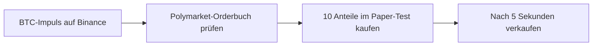

# BTC-Vorlauf: der Test einfach erklärt

Wir prüfen, ob sich BTC auf Binance bewegt, bevor Polymarket seine Preise
anpasst. Coinbase liefert zusätzliche Vergleichsdaten. Gehandelt wird
bisher ausschliesslich in einer Simulation.

Steigt BTC schnell genug, prüfen wir **Up**. Fällt BTC, prüfen wir **Down**.
Der Einstieg erfolgt zum simulierten Kaufpreis im Orderbuch. Der Ausstieg
erfolgt zum simulierten Verkaufspreis. Gebühren und verfügbare Stückzahl
zählen mit. Die Wahrscheinlichkeit bis zur Marktauflösung wird noch nicht
geschätzt.

| Parameter | Einstellung |
|---|---|
| Märkte | BTC Up/Down, 5 und 15 Minuten |
| Signal | Mindestens 0.02 % Bewegung auf Binance in 1 Sekunde |
| Richtung | Steigender BTC: Up; fallender BTC: Down |
| Einsatz | 10 Anteile je Trade, 100 USD Paper-Kapital je Variante |
| Einstiegsverzögerung | Getrennt 100, 250, 500 und 1’000 ms |
| Haltedauer | 5 Sekunden ab Einstieg |
| Kauflimit | Höchstens 0.85 USD und höchstens 0.02 USD über dem Ask beim Signal |
| Datenalter | Höchstens 2 Sekunden; vollständiger Snapshot erforderlich |
| Weitere Grenzen | 5 Sekunden Signalpause je Markt; höchstens eine offene Position je Markt |

Beispiel: Zeigt der Ask beim Signal 0.50 USD, darf der Einstieg höchstens
0.52 USD kosten. Ist der Preis bis zur simulierten Ankunft höher, fällt
der Trade aus. Ein steigender Ask allein garantiert keinen profitablen
Verkauf, denn verkauft wird zum Bid und es fallen Gebühren an.

Am 11.10.2026 wurde die langsame doppelte Textprüfung durch strikte native
UTF-8-Dekodierung ersetzt. Neue Märkte werden innerhalb der bestehenden
Verbindung abonniert. Die langsamen Marktinformationen werden parallel
abgerufen. Der bisherige Neustart jede Minute entfällt. Echte Fehler lösen
weiterhin eine Wiederverbindung aus; dann werden neue vollständige Bücher
benötigt. Überlauf der Datenwarteschlange macht den Lauf ungültig.

Der siebenminütige Live-Test vom 11.10.2026 ist beendet: 477’484
Orderbuchereignisse, ein Marktwechsel ohne Neustart, keine protokollierten
Verbindungsfehler. Es gab kein Handelssignal. Seit 11:56 Uhr Zürich laufen
drei weitere Stundenfenster; nach jedem folgt automatisch die Auswertung.

Jev ist noch nicht praktisch bewertet. Ein späterer Vergleich muss den
gleichen Kandidatenumfang und seine zusätzliche Antwortzeit berücksichtigen.

[Messungen, Ergebnisse und Startbefehle](cex_leadlag.md)
